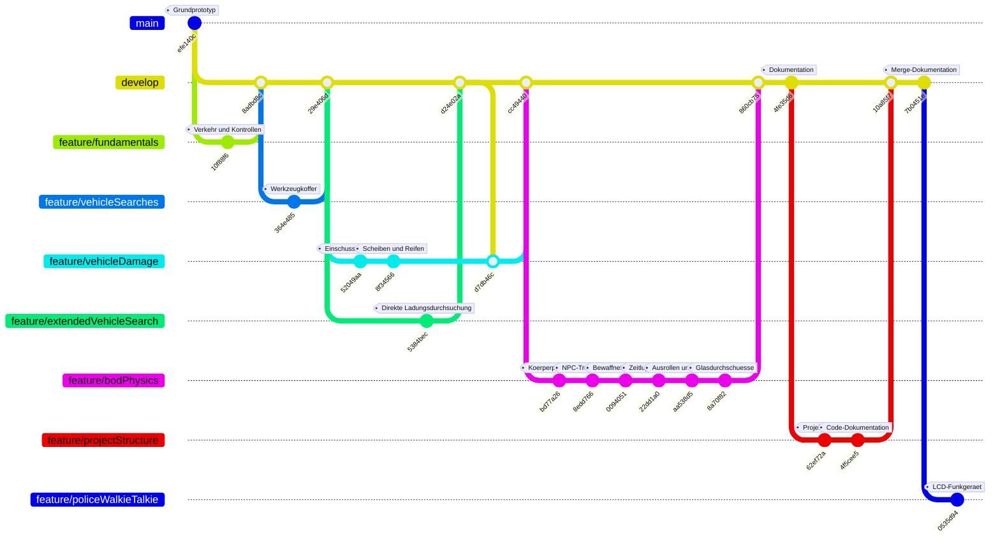

# Git-Branches als Buslinie

Stand: **13. November 2026**. Die farbigen Linien zeigen die tatsächlichen Abzweigungen und Zusammenführungen der Spielfunktionen. GitHub stellt das Mermaid-Diagramm direkt als Grafik dar.

Die Übersicht zeigt den **Spielstand nach PR #6 und die neue Funkgerät-Vorschau**. Sie fasst Zwischenstände zusammen; die angegebenen Commit-IDs bezeichnen Spielstände. Die anschließenden reinen Dokumentationscommits auf den einzelnen Branches sind nicht eingezeichnet.



**So liest du die Buslinie:** Jede Linie ist ein Branch, Punkte sind ausgewählte Commits. Eine Abzweigung startet einen Feature-Branch; eine zurücklaufende Verbindung übernimmt Änderungen. Die Verbindung von `develop` zu `feature/vehicleDamage` zeigt die damalige Aktualisierung des Feature-Branches mit der erweiterten Fahrzeugdurchsuchung, bevor die Fahrzeugschäden nach `develop` übernommen wurden.

## Noch auf GitHub vorhandene Branches

| Branch | Rolle / Status | Letzter Spielstand vor der Doku-Ergänzung |
| --- | --- | --- |
| `main` | Stabiler Ausgangsstand; spätere Spielfunktionen noch nicht übernommen | `efe140c` – Straße und Parkbucht |
| `develop` | Integrationsbranch inklusive Körperphysik, NPC-Testszene und neuer Projektstruktur | `10a85f7` – PR #6 übernommen |
| `feature/policeWalkieTalkie` | Laufende Funkgerät-Vorschau; Einsatzknöpfe noch ohne Aktion | `0535d94` – monochromes LCD mit vier Icon-Knöpfen |
| `feature/projectStructure` | Bereits in `develop` zusammengeführt, Remote-Branch noch vorhanden | `4f5cee5` – Projektstruktur und Code-Dokumentation |
| `feature/vehicleDamage` | Bereits in `develop` zusammengeführt, Remote-Branch noch vorhanden | `d7db46c` – Fahrzeugschäden inklusive damaligem `develop` |
| `feature/extendedVehicleSearch` | Bereits in `develop` zusammengeführt, Remote-Branch noch vorhanden | `5384bec` – Gegenstände direkt im Fahrzeug untersuchen |

`feature/fundamentals`, `feature/vehicleSearches` und `feature/bodPhysics` sind auf GitHub bereits gelöscht. Ihre historischen Linien bleiben im Diagramm sichtbar. Die Dokumentation legt diese Branches nicht erneut an. `feature/bodPhysics` ist die tatsächliche Schreibweise des vorhandenen Branches.

## Zusammenführungen

- [PR #6](https://github.com/Hauskamel/traffic-society/pull/6): `feature/projectStructure` → `develop`, zusammengeführt.

- [PR #1](https://github.com/Hauskamel/traffic-society/pull/1): `feature/fundamentals` → `develop`, zusammengeführt.
- [PR #2](https://github.com/Hauskamel/traffic-society/pull/2): `feature/vehicleSearches` → `develop`, zusammengeführt.
- [PR #4](https://github.com/Hauskamel/traffic-society/pull/4): `feature/extendedVehicleSearch` → `develop`, zusammengeführt.
- [PR #3](https://github.com/Hauskamel/traffic-society/pull/3): `develop` zunächst in `feature/vehicleDamage` aktualisiert, anschließend `feature/vehicleDamage` → `develop`, zusammengeführt.
- [PR #5](https://github.com/Hauskamel/traffic-society/pull/5): `feature/bodPhysics` → `develop`, zusammengeführt.

Die zeitliche Reihenfolge **#4 vor #3** ist beabsichtigt und entspricht der Git-Historie. Nach `main` wurden bislang keine späteren Spielfunktionen zusammengeführt. Dass diese Übersicht auch dort liegt, ändert den dortigen Spielstand nicht.

## Übersicht aktuell halten

Bei einem neuen Branch oder Merge dieses Diagramm, die Branch-Tabelle und das Standdatum aktualisieren. Nur tatsächlich zusammengeführte Funktionen als übernommen darstellen. Gelöschte Remote-Branches dürfen als historische Linien erhalten bleiben. Die Übersicht wird als reine Dokumentation auf allen noch vorhandenen Remote-Branches gepflegt; Spielfunktionen werden ausschließlich über den [Git-Arbeitsablauf](GIT-WORKFLOW.md) integriert.

Für den vollständigen lokalen Verlauf:

```bash
git fetch origin --prune
git log --graph --oneline --decorate --all
```
